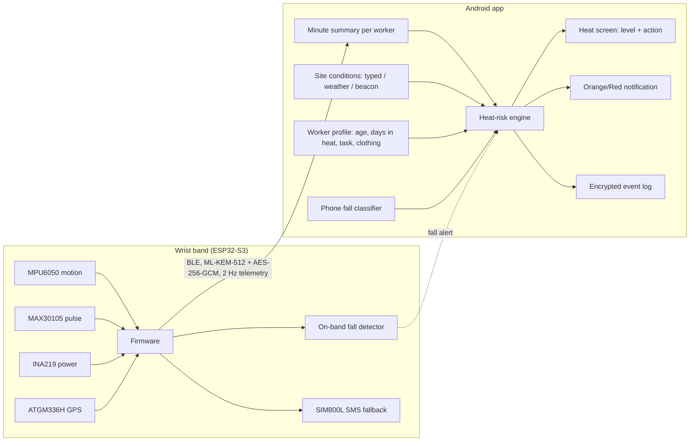

# HeatGuard: technical documentation

**Future Health Digital Innovation Challenge, Challenge 07: Climate-Resilient Worker Health**

HeatGuard is a wrist-worn band and a phone app that warn outdoor workers and their supervisors about heat strain *before* a worker collapses. Every minute it combines four things:

- **site heat:** WBGT from a typed reading, the weather or a site beacon
- **workload:** the declared task, raised by wrist motion when needed
- **acclimatization:** how many days the worker has been working in this heat
- **the worker's own heart rate,** which is optional and needs consent

From these it gives one of four levels, **Green / Yellow / Orange / Red**, each with a single plain action. It never shows a raw risk score.

HeatGuard builds on the EchoWear wearable, an existing fall-detection band. Folder and package names in the code still say `EchoWear`.

---

## 1. System architecture



| Layer | What it does | Where |
|---|---|---|
| Band firmware | Motion, pulse, battery, GPS. Detects falls on the band. Sends telemetry twice a second over an encrypted BLE link. Sends an SMS itself if the phone is out of reach. | `EchoWear_Headless/`, `EchoWear_TouchLCD_Unified/` |
| Minute summary | Turns about 120 telemetry packets into one minute: median heart rate, a heart-rate quality score (from the band's motion tiers), and wrist motion intensity (ENMO). | `.../heat/HeatMonitor.kt` |
| Heat-risk engine | The model in section 2. One engine per worker. | `.../heat/HeatRiskEngine.kt`, `HeatScience.kt` |
| Site conditions | Best available site heat: beacon (within 5 min), then a typed reading (within 4 h), then opt-in weather (within 90 min). | `.../heat/SiteConditions.kt` |
| Reference model | Python version of the engine, the source of truth for the numbers. | `HeatRisk/` |

The engine runs on the phone, not the band. The phone already hosts EchoWear's ML, and the band has no screen on the headless model.

## 2. How the risk is worked out

| Step | Method | Source |
|---|---|---|
| Core temperature | Estimated from the minute's heart rate with the **ECTemp** Kalman filter | Buller et al., *Physiol. Meas.* 34:781 (2013) |
| Heat strain 0-10 | **Physiological Strain Index** from estimated core temp and heart rate, against the worker's shift-start baseline | Moran et al., *Am. J. Physiol.* 275:R129 (1998) |
| Site heat | **WBGT** estimated as the higher of the Australian BoM formula (air temp + humidity) and the ISO 7243 outdoor form with a black globe. With no wet-bulb sensor, the higher estimate is the safer error. | BoM; Stull, *J. Appl. Meteor. Climatol.* 50:2267 (2011) |
| Safe limit | **ACGIH TLV** (acclimatized) and **Action Limit** (new workers), blended over the first 7 days. Clothing adjustment values added. | ACGIH heat-stress TLV |
| Work/rest schedule | Minutes of work per hour that keep the hourly average metabolic rate under the limit | ACGIH time-weighted method |
| Workload | Higher of the declared task and the wrist motion class | Hildebrand et al., *MSSE* 46:1816 (2014) |
| Stop limits | Estimated core temp 38.0 °C (new) to 38.5 °C (acclimatized); 5-minute heart rate above 180 − age | ACGIH |

**Levels and actions**

| Level | Triggered by | Action shown |
|---|---|---|
| Green | Site heat more than 2 °C under the limit, low strain | Keep working, drink water every 15-20 min |
| Yellow | Site heat near or over the limit but a work/rest cycle is safe; core temp rising; strain ≥ 3 | Water and shade, or "work N min, rest 60 − N min each hour" |
| Orange | No safe amount of work at this heat; core temp near the stop limit; strain ≥ 5 | Stop, rest in shade, cool down |
| Red | Core temp at the stop limit; strain ≥ 7; sustained very high heart rate; fall or collapse | Stop and tell the supervisor, or emergency for a collapse during heat strain |

**Safety rules built into the engine**

- **Missing data:** a missing value is shown as "not measured", never as 0 and never as "safe". During heavy motion the pulse sensor is unreliable, so those beats are discarded rather than trusted.
- **Escalation and stand-down:** warnings go up immediately but come down only after 10 calm minutes, so one cool reading can't clear a warning.
- **Collapse:** a fall during heat strain latches Red until a person confirms it has been handled.

## 3. Data: sources and assumptions

| Data | Source | Use |
|---|---|---|
| Heart rate, motion | The worker's own band, with consent | Live engine input |
| Site heat | Supervisor's reading, Open-Meteo current weather (opt-in), site beacon (in progress) | Live engine input |
| HIFD wrist fall dataset (21 young adults, 50 Hz) | Public research dataset, Zenodo record 10013090 | Training and evaluation of the existing fall model |
| Simulated shifts | `HeatRisk/sim/demo_shift.py` (toy heat-balance model) | Demonstration and regression tests only |

The organisers provided no data, and **no real worker data was collected** for this submission. Assumptions, all stated in the code:

- Worker metabolic rates use the ACGIH / ISO 8996 reference values for each task class.
- Acclimatization is linear over 7 days (NIOSH guidance is 7-14 days).
- Site heat applies to everyone on the site. The engine does not model shade or position for each worker.
- ECTemp's published parameters (fitted on soldiers and athletes) apply to this workforce. **This is not yet verified.**

## 4. Clinical boundaries

- HeatGuard is a **safety and wellness aid, not a medical device**. It does not diagnose heat illness.
- Core temperature is an **estimate from heart rate**, shown with its uncertainty (± filter spread + 0.3 °C), and labelled as an estimate on every screen.
- Red with "emergency" means: call for medical help and start cooling. Clinical judgement stays with people.
- It must not be used to push workers harder. Recommendations only ever reduce work: the wrist can raise the task class, never lower it.

## 5. How each challenge requirement is met

| Requirement | Status | How |
|---|---|---|
| 1. Dynamic heat-risk assessment | **Built** | Site WBGT + workload + clothing + acclimatization + optional heart-rate-based core-temp estimate, every minute, per worker. |
| 2. Clear, graded warnings | **Built, English only** | Four levels with words as well as colour, one action each, work/rest minutes, phone notifications on Orange/Red. All text sits behind translation keys; Arabic, Hindi/Urdu, Bengali and Tagalog are **not yet translated**. |
| 3. Worker-first governance | **Built in design** | Heart-rate monitoring can be switched off per worker. Data stays on the phone. The BLE link is encrypted (ML-KEM-512 + AES-256-GCM) and the store is encrypted (SQLCipher). The supervisor view and notifications carry level and action only, never vitals. Weather is opt-in and sends only the site position rounded to about 1 km. A written consent screen and enforced access roles are **not yet built**. |
| 4. Field-ready operation | **Partly** | Fallbacks exist: heart rate during heavy motion → "not measured"; no site data → "not measured"; phone out of range → the band sends its own SMS. **Not tested** in real heat, dust, PPE or for battery life. |
| 5. Supervisor decision support | **Partly** | Roster of workers, each with level, action and work/rest minutes. A combined crew/site dashboard is **not yet built**. |
| 6. Safety and productivity measures | **Partly** | Every Orange/Red is logged with time, reasons and site heat, and can be exported as CSV, so lead time and escalation counts can be reported. False-alarm rate and adherence need a field pilot. |

## 6. Testing and results

**Software tests (all passing)**

| Suite | Tests | What it checks |
|---|---|---|
| Python `HeatRisk/tests` | 29 | Published reference points (Stull wet bulb, ACGIH limits, ECTemp), every level path, cool-down, collapse latch, missing data, supervisor view |
| Kotlin `HeatGoldenTest` | 4 | Replays **4,770 minutes** (3 demo + 12 randomized shifts). The Kotlin engine matches the Python engine on every level, action, reason and number (to 1e-9). A planted 0.01 °C threshold change makes it fail. |
| Kotlin `MinuteAggregatorTest` | 6 | Minute summary: median heart rate, quality, motion, off-wrist, new shift after a 3-hour gap |
| Kotlin `DemoShiftTest` | 3 | The in-app demo replay matches the Python demo minute for minute |

**Simulated shift** (hot morning 06:00-12:30, WBGT 29-34 °C, moderate work; toy physiology, illustrative only)

| Run | Peak core temp (simulated) | Minutes ≥ 38.5 °C | First Orange | First Red | Collapse |
|---|---|---|---|---|---|
| A. Acclimatized, ignores warnings | 39.5 °C | 200 | 07:49 | 08:28 | 10:18 |
| B. Acclimatized, follows warnings | 37.95 °C | 0 | 08:01 | never | none |
| C. New worker (day 2), follows | 37.94 °C | 0 | 06:57 | never | none |

In run A the first Red came **1 h 50 min before the simulated collapse**.

**Fall detection** (existing EchoWear work, HIFD dataset, subject-wise cross-validation)

| Method | Sensitivity | Specificity |
|---|---|---|
| Phone 1D-CNN (22 KB INT8) | 90.4 % | 95.5 % |
| Band two-stage detector | 88.5 % | 93.5 % |

**On a phone:** the app has been installed and run on a TECNO KG6 (Android 11). The Heat screen, typed site readings (WBGT shown correctly) and saving across restarts were checked there.

## 7. Limitations

1. **No real-world validation yet.** The demo's "true" core temperature comes from a simple model written for the demo. It shows the logic behaves sensibly, not that it is accurate. In the demo, the estimate reads 0.3-0.5 °C below the simulated value while temperature is rising.
2. **ECTemp has not been validated for Gulf outdoor workers.** Its accuracy also depends on wrist pulse readings, which are poor during hard work.
3. **WBGT is estimated,** not measured with a natural wet-bulb thermometer.
4. **Wrist motion misses** carrying and static effort. The declared task sets the floor.
5. **The fall model was trained on young adults** doing scripted falls, not on real collapses.
6. **Not built yet:** translations, a consent screen, access roles, the site beacon, and a crew-level dashboard.
7. **Battery life** with heat monitoring has not been measured.

## 8. Path to a pilot

1. **Validation study:** about 20 consenting outdoor workers wearing the band and an ingestible core-temperature pill, to measure ECTemp error in this population and tune thresholds.
2. **Site beacon:** air temperature, humidity and black-globe probe on an ESP32, broadcasting to every phone on site.
3. **Translations and consent flow,** with worker representatives involved.
4. **Pilot with one construction or logistics site** in the hot season, reporting alert lead time, false alarms, adherence to breaks, heat incidents and lost work time (requirement 6).

## 9. Build and run

```bash
# Python reference engine and tests
cd HeatRisk
python -m unittest discover -s tests -t .
python -m sim.demo_shift          # prints the three simulated shifts
python -m sim.export_golden       # regenerates the Kotlin golden test vectors
python -m sim.export_demo         # regenerates the in-app demo shifts
```

```bash
# Android app (needs Android Studio's JDK as JAVA_HOME)
cd EchoWear_Android
./gradlew :app:testDebugUnitTest
./gradlew :app:assembleDebug      # app/build/outputs/apk/debug/app-debug.apk
```

The firmware builds with the Arduino IDE for an ESP32-S3. It needs the `NimBLE-Arduino`, `TinyGPS++` and `PQCMicro` libraries. Set `CAREGIVER_PHONE` before flashing.
